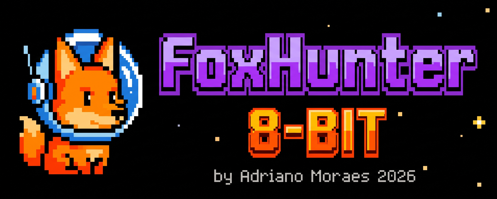

# Don't Drawer Your Badge: Foxhunter 8-Bit 🦊📡

Turning the BSides Lisbon ESP32-C6 badge into a Multi-Spectrum Threat Radar. 



This repository contains the source code and documentation for **Foxhunter 8-Bit**, a custom firmware designed to repurpose a conference badge into a pocket RF sensor capable of monitoring 2.4GHz traffic across Wi-Fi, BLE, and Zigbee protocols. 

Presented at **BSides Lisbon 2026** by Adriano Dias Moraes.

---

## 📂 Repository Structure

- `Foxhunter 8bit/`: The main source code for the Multi-Spectrum Threat Radar firmware.
- `Bsides badge 2025 dump/`: Original files, firmware dump, and reference material from the stock badge.
- `pong.ino`: A standalone, functional, flicker-free Pong game written for the badge hardware.
- `Foxhunter_logo.jpeg`: The official logo for the project.

---

## 🛡️ About the Hardware Badge

The BSides Lisbon 2025 badge was designed by Pedro Umbelino ([kripthor](https://www.linkedin.com/in/pedroumbelino/)) to be a fully functional, battery-powered game pad with state-of-the-art Wi-Fi. It features the ESP32-C6 microcontroller, 6 buttons, USB charging, a color LCD, and breakout pins.

For official documentation on the microcontroller, refer to the Espressif Systems datasheet:
🔗 [ESP32-C6-MINI-1 / MINI-1U Datasheet (PDF)](https://documentation.espressif.com/esp32-c6-mini-1_mini-1u_datasheet_en.pdf)

### The "Analog Seppuku" and Power Delivery Issue

See write up about this [here](https://www.linkedin.com/pulse/hardware-badges-analog-seppuku-pedro-umbelino-x6r3e/).

During the 2025 conference, roughly 6% of the badges catastrophically failed—summoning "magic smoke", due to issues with the battery management IC (the IP5305T) and the associated inductor. 

As detailed in Pedro's post-mortem analysis:
1. **Inductor Saturation:** The inductors had wide spreads in saturation current. Units on the low end entered saturation earlier, producing higher current spikes during Wi-Fi bursts.
2. **IC Suitability:** The IP5305T was primarily designed for power banks (which demand stable, low-transient current), whereas this board operates with Wi-Fi transmission bursts, requiring an IC capable of handling fast, high di/dt load transients.
3. **Tolerance Stacking:** Minor variations in PCB trace impedance, solder joints, and component placement resulted in a feedback loop of heat and degradation for some boards.

**Pragmatic Fix:** To prevent this project from frying your badge, **ditch the internal Li-Po battery entirely.** Run the badge 100% tethered over USB using a standard power bank.

---

## 🦊 Foxhunter 8-Bit Features

Foxhunter 8-Bit utilizes a passive radar and "foxhunt" architecture:

1. **Wi-Fi 6 (802.11 b/g/n/ax)**: Promiscuous mode capturing raw management frames (Beacons, Probe Requests, Deauths) across channels 1–14 to map infrastructure and spot rogue APs.
2. **BLE 5.0 / 5.3**: Passive listening on advertising channels (37, 38, 39) to parse raw PDUs, manufacturer payloads, and track devices like Apple AirTags.
3. **IEEE 802.15.4 (Zigbee / Thread)**: Sniffing raw MAC primitives and beacons.
4. **Foxhunt UI + Radar HUD**: Plots targets on radar rings and tracks live signal peaks. Physical proximity is estimated by smoothing raw RSSI spikes using a Weighted Moving Average (WMA) filter.

---

## 🏓 Bonus: Playable Pong Prototype (`pong.ino`)

Included in the root of this repository is `pong.ino`, the original proof-of-concept game I wrote while reverse-engineering the badge's hardware pins[cite: 2.2]. 

If you want a lightweight project to test your badge's screen and buttons before diving into the RF tools, you can flash this file.

**Pong Features:**
*   **Two-Player Local Multiplayer:** Uses the Left directional pad for Player 1 (Up/Down) and the right action buttons (A/B) for Player 2. 
*   **Optimized Rendering:** Uses targeted screen repairs (redrawing only the moving elements) instead of full-screen wipes to ensure fast, 60 FPS flicker-free gameplay on the ST7789 display[cite: 2.3].
*   **Dependencies:** Just requires the `Adafruit_GFX` and `Adafruit_ST7789` libraries[cite: 2.3] to run.

---

## 💾 How to Backup the Original Firmware

Before installing Foxhunter 8-Bit, you may want to back up your badge's current flash memory so you can restore the original game later. 

> **Note on restoring the original game:** A factory dump obtained directly from my own stock badge is already included in this repository under the `Bsides badge 2025 dump/` folder. Alternatively, if you want to compile and restore the original code from scratch, the complete source code for the BSides Lisbon 2025 badge can be found in the official repository here: 
> 🔗 [bsideslisbon2025-badge by kripthor](https://github.com/kripthor/bsideslisbon2025-badge/tree/main)

If you still want to back up your specific badge's current state (using `esptool.py`), follow these steps:

1. **Install esptool:** If you don't have it installed, run:
   ```bash
   pip install esptool
   ```
2. **Read the Flash:** Run the following command to dump the entire 4MB flash to a file named `original_firmware.bin`:
   ```bash
   esptool.py -p <YOUR_PORT> -b 460800 read_flash 0x0 0x400000 original_firmware.bin
   ```
   *(Replace `<YOUR_PORT>` with your actual serial port, e.g., `/dev/ttyACM0` on Linux/macOS or `COM3` on Windows).*
3. **Restore (Optional):** If you ever want to revert back using your dump (or the one provided in the repository), run:
   ```bash
   esptool.py -p <YOUR_PORT> -b 460800 write_flash 0x0 original_firmware.bin
   ```

---

## 🚀 How to Run and Install

1. **Clone the Repository:**
   ```bash
   git clone [https://github.com/adrianomoraes/Don-t-Drawer-Your-Badge-Bsides-2026-.git](https://github.com/adrianomoraes/Don-t-Drawer-Your-Badge-Bsides-2026-.git)
   ```
2. **Configure the Arduino IDE for ESP32-C6:**
   * **Add Board Manager URL:** Open **File > Preferences**. In the "Additional Boards Manager URLs" field, paste `https://espressif.github.io/arduino-esp32/package_esp32_index.json` and click OK.
   * **Install the ESP32 Core:** Go to **Tools > Board > Boards Manager**. Search for `esp32` and install the package by **Espressif Systems** *(ensure you install version 3.0.0 or newer, as earlier versions do not support the C6)*.
   * **Select the Board:** Go to **Tools > Board > esp32** and select **ESP32C6 Dev Module**.
   * **Configure Board Settings:** Under the **Tools** menu, ensure the following configurations are set:
     * **USB CDC On Boot:** `Enabled` *(Critical: without this, the ESP32-C6 native USB will not send data to your Serial Monitor)*.
     * **Flash Size:** `4MB (32Mb)`
     * **Port:** Select the COM or `/dev/tty` port your badge is connected to.
3. **Install Dependencies:**
   Open the Arduino Library Manager (`Sketch` > `Include Library` > `Manage Libraries...`) and install the following required external libraries:
   *   **Arduino_GFX_Library** (for driving the display)
   *   **NimBLE-Arduino** (for optimized Bluetooth Low Energy handling)
   *   **ArduinoJson** (for parsing signature configurations)
   
   *(Note: Headers like `WiFi.h`, `LittleFS.h`, `esp_wifi.h`, and `esp_ieee802154.h` are built directly into the ESP32 core and do not require separate installation. Local headers like `SafeQR.h` and `logo.h` are already included in the repository. The filesystem data is created automatically on the first run, so no LittleFS upload tool is required).*
4. **Compile and Flash:**
   Open the `Foxhunter 8bit/` folder in the Arduino IDE, connect the badge via USB, and hit upload.

### 🚑 Troubleshooting: The Hardware Rescue Method
If you flash code that bricks the native USB (e.g., misconfiguring GPIO 12/13) and you lose serial connection, do not panic:
1. Unplug the USB.
2. Press and **hold the LEFT button** (which is wired to the GPIO 9 hardware strapping pin).
3. Plug the USB back in while holding the button.
4. The board will force the ROM Bootloader mode, bypassing the bad firmware and allowing you to re-flash safely.
